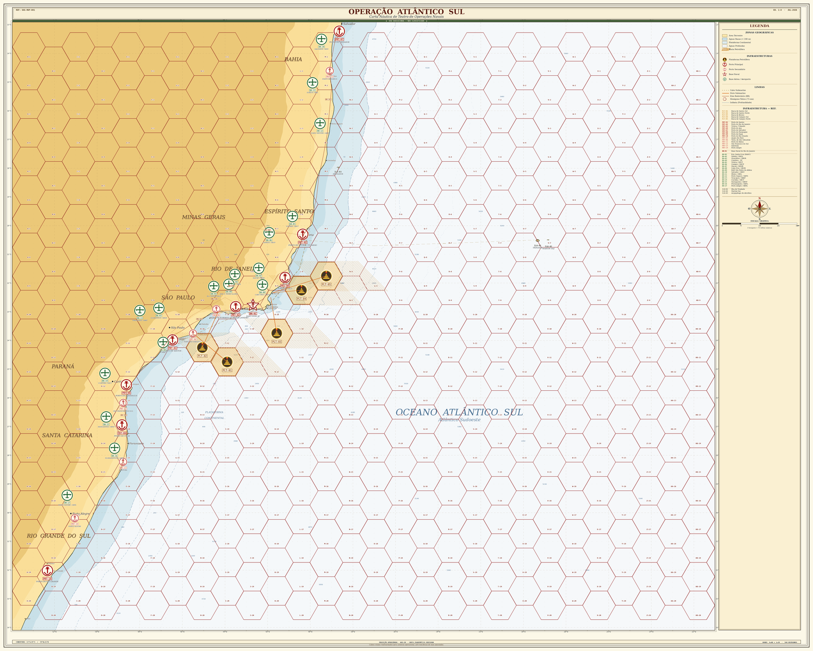
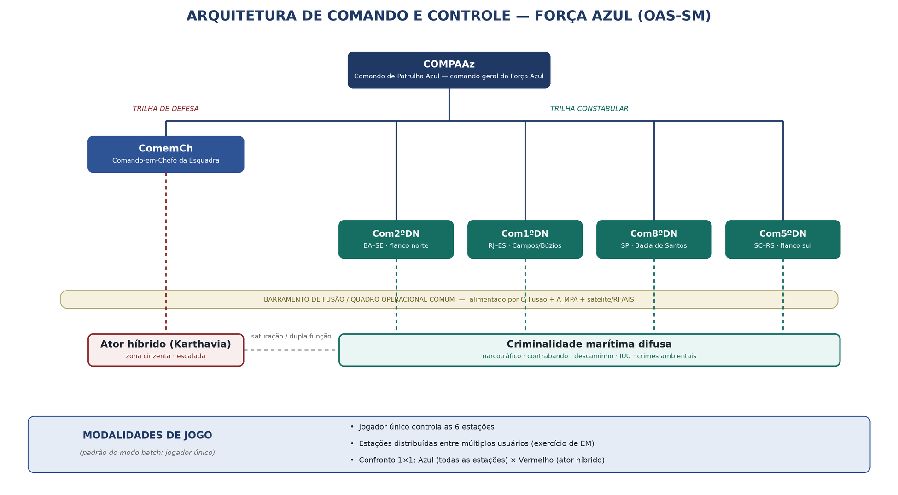

**OPERAÇÃO ATLÂNTICO SUL**

**VARIANTE DE SEGURANÇA MARÍTIMA (OAS-SM)**

**Conceito Operacional**

**e Regras da Variante**

**de Segurança Marítima**

*Adaptação do jogo de guerra para o espectro de Maritime Security e
ameaças híbridas*

**Versão 1.6**

Documento de Trabalho — OAS-SM/CR

DOCUMENTO FICTÍCIO — USO EDUCACIONAL E DE PESQUISA

**Aviso**

Este documento integra o cenário fictício da *Operação Atlântico Sul* e
sua variante de Segurança Marítima (OAS-SM). Foi elaborado
exclusivamente para instrução militar e como instrumento de pesquisa em
simulação construtiva no contexto do Planejamento Baseado em Capacidades
(PBC). A República de Karthavia, suas forças e seus dirigentes são
inteiramente fictícios e não guardam correspondência com Estados,
organizações ou pessoas reais. O cenário não representa condição
esperada ou desejada, nem expressa posição oficial de qualquer
instituição.

Os valores paramétricos de ameaças, sensores, defesas e custos indicados
neste texto são *placeholders* de projeto, a serem substituídos por
dados validados por especialistas antes de qualquer uso analítico
conclusivo. A denominação e as jurisdições das estações de comando
seguem a organização de referência adotada no projeto.

**Sumário**

**1 Propósito e Escopo**

A variante de Segurança Marítima (doravante **OAS-SM**) adapta a
Operação Atlântico Sul de um cenário de guerra naval de alta intensidade
para o espectro de operações de *Maritime Security* e de ameaças
híbridas. O objetivo é ampliar o valor educacional e analítico do jogo
para os problemas que dominam o emprego corrente do poder naval em tempo
de “não-paz, não-guerra”: presença, vigilância, interdição, aplicação da
lei no mar, proteção da infraestrutura crítica offshore e gestão de
escalada sob ambiguidade deliberada.

**1.1 Relação com o OAS base**

A OAS-SM não substitui o jogo base: reutiliza sua geografia, sua carta
náutica, sua ordem de batalha Azul, o centro de gravidade (as
plataformas FPSO das bacias de Santos, Campos e Búzios) e a arquitetura
de software. O adversário estatal permanece a República de Karthavia. A
diferença está no modo de emprego: em vez de operar abertamente,
Karthavia atua predominantemente abaixo do limiar do conflito armado, e
a esse adversário soma-se uma camada difusa de criminalidade marítima.

**1.2 Mudança de paradigma**

O jogo base resolve um problema de destruição: a variável central é a
salva (modelo de Hughes) e o desfecho é o atrito. A OAS-SM desloca a
variável central para a tríade detecção – atribuição – resposta
graduada. A vitória Azul deixa de ser “afundar o oponente” e passa a ser
“preservar a infraestrutura e a ordem marítima sem escalar
desnecessariamente”. A vitória Vermelha é degradar, intimidar e coagir
mantendo a negação plausível.

**1.3 Carta oficial de referência**

A carta **OAS-MAP-001, Ed. 2.0 (jul/2026)** é a carta oficial do teatro
de operações da OAS-SM. Cobre a faixa de 13°S a 34°S, do flanco norte
(Salvador) ao sul (Rio Grande), com foco na área Santos – Espírito
Santo, e representa as plataformas (PLT-01 a 05), os portos (PRT), as
bases navais e aéreas, os cabos e dutos submarinos e as bacias
petrolíferas.

*Figura 1.1. Carta OAS-MAP-001, Ed. 2.0 — Carta Náutica de Teatro de
Operações Navais (OAS-SM).*

**1.4 O que se preserva**

- Mapa hexagonal, carta náutica (OAS-MAP-001) e escala espacial.

- FPSOs, cabos e dutos submarinos e as SLOC como centro de gravidade.

- RNG semeado e o motor de salva (agora como caso-limite de escalada
  terminal).

- Arquitetura engine/game/agents/runner e os desenhos ablação +
  fatorial.

**2 Ambiente Operacional de Segurança Marítima**

**2.1 Camadas do ambiente**

A OAS-SM organiza o espaço em três faixas funcionais sobrepostas ao
mesmo tabuleiro hexagonal, sem alterar a malha: águas azuis (rotas
oceânicas e SLOC), águas marrons/verdes (aproximações litorâneas,
terminais e ZEE) e o domínio submarino de infraestrutura (cabos de
dados, dutos e umbilicais). Cada faixa tem ameaças, sensores e respostas
típicas distintas.

**2.2 O centro de gravidade**

O centro de gravidade Azul é a continuidade de funcionamento da
infraestrutura crítica, a segurança das linhas de comunicação marítima e
a manutenção da ordem no mar. O alvo não precisa ser afundado para gerar
efeito: basta interromper a produção, elevar seguro e frete, ou afastar
o tráfego pela percepção de insegurança. A proteção é, portanto, um
problema de negação de efeitos, não apenas de proteção física.

**2.3 A lógica da ambiguidade**

O eixo estruturante é a negação plausível. Toda ação Vermelha
bem-sucedida e não atribuída mantém o jogo na zona cinzenta — onde o
híbrido é mais eficaz. A resposta Azul carrega custo político quando é
desproporcional, precoce ou baseada em atribuição frágil. O jogador
convive com o dilema permanente entre agir cedo (e arriscar o erro) ou
esperar por evidência (e arriscar o dano).

**3 As Duas Trilhas de Ameaça**

A OAS-SM opera em dois eixos simultâneos. A trilha de defesa trata do
ator híbrido estatal; a trilha constabular trata da criminalidade
marítima difusa. São problemas distintos, com estações líderes e
métricas próprias, mas deliberadamente acoplados: parte das ocorrências
criminais é instrumentalizada pelo híbrido para saturar e dispersar a
resposta Azul. A essas duas trilhas sobrepõe-se uma dimensão
informacional e cognitiva (Seção 6), transversal a ambas, em que se
disputa a confiança e o apoio às ações da Força Azul.

| **Dimensão**     | **Trilha de defesa**                   | **Trilha constabular**                             |
|------------------|----------------------------------------|----------------------------------------------------|
| Ator             | Estado híbrido (Karthavia)             | Atores criminais diversos, sem comando central     |
| Limiar           | Zona cinzenta → conflito               | Aplicação da lei e ordem pública no mar            |
| Problema central | Atribuição e gestão de escalada        | Detecção, fiscalização e resposta de rotina        |
| Estação líder    | ComemCh                                | Distritos Navais (2º, 1º, 8º, 5º)                  |
| Efeito medido    | Proteção de IC e contenção da escalada | Governança e ordem marítima                        |
| **Acoplamento**  | —                                      | Parte é instrumentalizada pelo híbrido (saturação) |

*Tabela 3.1. As duas trilhas de ameaça da OAS-SM.*

**4 Trilha de Defesa — Ameaça Híbrida**

Karthavia emprega um repertório de ações graduadas e sincronizadas,
projetadas para explorar as lacunas de consciência situacional e
permanecer sob o limiar que legitimaria a resposta robusta.

**4.1 Catálogo de ameaças híbridas**

| **Ameaça**                     | **Vetor / descrição**                                                                     | **Negab.** | **Contramedida Azul de referência**                            |
|--------------------------------|-------------------------------------------------------------------------------------------|------------|----------------------------------------------------------------|
| Frota-sombra (dark shipping)   | Mercantes com AIS desligado/falsificado, bandeira de conveniência, empresas de fachada.   | Alta       | Fusão AIS forense + satélite/RF; interdição.                   |
| Milícia marítima               | “Pesqueiros” paramilitares; presença coercitiva e enxameamento em torno dos FPSOs.        | Alta       | Presença de NPaOc; abordagem; documentação de conduta.         |
| Sabotagem submarina            | Danos a cabos, dutos e umbilicais: âncora “acidental”, mergulhadores, veículos autônomos. | Muito alta | Vigilância de campo; zona de exclusão; ROV de inspeção.        |
| USV/UAV anônimos               | Reconhecimento persistente e ataques negáveis a unidades e terminais.                     | Alta       | Sensoriamento antiacesso; GE; meios não tripulados.            |
| Interferência GNSS             | Jamming/spoofing; degrada VTS e o posicionamento dinâmico dos FPSOs.                      | Média      | Navegação alternativa; detecção de RF; hardening.              |
| Ciberataque a terminais/portos | Comprometimento de VTS, SCADA e logística portuária.                                      | Média      | Defesa cibernética; redundância; resposta a incidentes.        |
| Minagem encoberta              | Poucos artefatos em aproximações portuárias, sem reivindicação.                           | Alta       | MCM (inclusive não tripulada); rota alternada; alerta.         |
| Lawfare e narrativas           | Explora respostas Azuis desproporcionais para gerar custo político.                       | —          | Proporcionalidade; prova documentada; comunicação estratégica. |

*Tabela 4.1. Catálogo de ameaças híbridas (parâmetros a validar).*

**4.2 Sincronização e saturação**

A eficácia Vermelha vem da combinação: um evento de pesca ilegal massiva
atrai as patrulhas para um flanco enquanto uma âncora “acidental”
degrada um cabo no flanco oposto, sob interferência GNSS que retarda a
atribuição. O jogo premia o Vermelho por dispersar a atenção Azul e o
penaliza quando concentra ações a ponto de tornar a atribuição
inequívoca.

**5 Trilha Constabular — Criminalidade Marítima Difusa**

Além do ator híbrido, a OAS-SM mantém o fluxo contínuo de ocorrências de
segurança marítima conduzidas por atores comuns, sem comando central.
Elas constituem a carga de rotina da autoridade marítima e são geradas
estocasticamente ao longo da campanha, com incidência por área.

**5.1 Catálogo de ocorrências**

| **Ocorrência**           | **Descrição**                                                 | **Resposta de referência**              | **Exploração pelo híbrido**                     |
|--------------------------|---------------------------------------------------------------|-----------------------------------------|-------------------------------------------------|
| Narcotráfico             | Transporte marítimo de entorpecentes em embarcações diversas. | Interceptação, abordagem e apreensão.   | Rota para infiltração de meios e logística.     |
| Contrabando / descaminho | Mercadoria ilícita ou com sonegação fiscal.                   | Interdição e ação aduaneira coordenada. | Financiamento e cobertura logística de proxies. |
| Pesca irregular (IUU)    | Pesca não autorizada na ZEE, em volume.                       | Fiscalização e apresamento.             | Saturação e mascaramento (milícia marítima).    |
| Crimes ambientais        | Poluição, descarte ilegal, pesca predatória.                  | Fiscalização e responsabilização.       | Degradação deliberada próxima a IC como coação. |
| Pirataria / roubo armado | Assalto a embarcações e terminais.                            | Resposta de segurança; escolta.         | Cobertura negável para ataques a IC.            |
| Imigração irregular      | Fluxo marítimo irregular de pessoas.                          | SAR e controle; tratamento humanitário. | Vetor de saturação e crise humanitária.         |

*Tabela 5.1. Catálogo de ocorrências da trilha constabular.*

**5.2 Dupla função e acoplamento**

Cada ocorrência cumpre duas funções simultâneas. Como objetivo legítimo,
exige resposta e pontua na métrica de governança/ordem marítima. Como
vetor de saturação, consome capacidade Azul e cria janelas para a ação
híbrida. O jogador que trata tudo como crime comum perde o híbrido de
vista; o que trata tudo como híbrido desperdiça capacidade e incorre em
custo político. O acerto está na triagem: distinguir o incidente de
rotina daquele que é cobertura para a trilha de defesa — decisão que
depende diretamente da qualidade da fusão de dados.

**6 Dimensão Informacional e Cognitiva**

Sobreposta às trilhas de defesa e constabular, a OAS-SM modela uma
dimensão informacional e cognitiva, em que o objeto disputado não é a
embarcação nem a infraestrutura, mas a confiança da sociedade e o apoio
às ações das forças armadas de Azul. É o terreno da legitimidade: ações
materialmente corretas podem ser esvaziadas por uma narrativa adversa, e
ações frágeis podem ser amplificadas contra a Força Azul.

**6.1 Ação Vermelha — campanhas de desinformação**

O ator híbrido pode conduzir campanhas de desinformação para reduzir a
confiança e o apoio às ações de Azul: distorcer um apresamento legítimo
como abuso, fabricar dano ambiental atribuído à Marinha, inflar o custo
humano de uma interdição, explorar um incidente real para generalizar
desconfiança. O efeito é degradar o apoio público, estreitar as regras
de engajamento efetivas e elevar o custo político de cada resposta Azul
— sinérgico com o lawfare já previsto na trilha de defesa.

**6.2 Ação Azul — campanhas informacionais**

Azul, por sua vez, desenvolve campanhas informacionais para se proteger
nessa dimensão: comunicação estratégica, transparência proativa,
divulgação de provas documentadas (vídeo de abordagem, laudo ambiental,
registro de SAR) e prebunking de narrativas prováveis. O efeito é
preservar ou recuperar o apoio público, ampliar a margem de ação
legítima e reduzir o custo político das respostas — sem jamais recorrer
a desinformação, mantendo a assimetria de legitimidade a favor de Azul.

**6.3 Mecânica e acoplamento**

A dimensão é representada por um indicador de **apoio público /
confiança** que se move com os eventos no mar e com as campanhas de cada
lado. Ele modula o custo político (Seção 11.3) e a largura das regras de
engajamento: apoio alto amplia a margem de resposta; apoio baixo a
estreita e encarece politicamente cada ação. As campanhas são ações
próprias — consomem tempo e recurso — e sua eficácia depende da
qualidade da fusão e da prova disponível, ligando esta dimensão à
consciência situacional das demais.

| **Aspecto**    | **Vermelho (desinformação)**                           | **Azul (campanha informacional)**                          |
|----------------|--------------------------------------------------------|------------------------------------------------------------|
| Objetivo       | Reduzir confiança e apoio às ações de Azul.            | Preservar/recuperar apoio e legitimidade.                  |
| Meios          | Narrativa adversa, fabricação, amplificação.           | Comunicação estratégica, transparência, prova, prebunking. |
| Gatilho típico | Incidente real ou fabricado envolvendo Azul.           | Ação bem conduzida; antecipação de narrativa.              |
| Efeito no jogo | ↓ apoio público; ↑ custo político; ROE mais estreitas. | ↑ apoio público; ↓ custo político; ROE mais amplas.        |

*Tabela 6.1. Disputa na dimensão informacional e cognitiva.*

**7 Estrutura de Comando e Controle**

A Força Azul é articulada em seis estações de comando e controle,
organizadas em duas camadas. No ápice está o COMPAAz; abaixo, o ComemCh
conduz a trilha de defesa e os quatro Distritos Navais conduzem a trilha
constabular em suas áreas.

*Figura 7.1. Arquitetura de comando e controle da Força Azul (OAS-SM).*

**7.1 As seis estações**

| **Estação** | **Denominação**              | **Nível** | **Trilha**  | **Responsabilidades principais**                                                               |
|-------------|------------------------------|-----------|-------------|------------------------------------------------------------------------------------------------|
| **COMPAAz** | Comando de Patrulha Azul     | Ápice     | Transversal | Comando geral da Força Azul; prioriza o esforço entre trilhas; aloca ISR; autoriza a escalada. |
| **ComemCh** | Comando-em-Chefe da Esquadra | Subord.   | Defesa      | Emprega as forças de esquadra contra o híbrido; conduz a escalada (N2–N3).                     |
| **Com2ºDN** | Comando do 2º Distrito Naval | Subord.   | Constabular | Autoridade marítima BA–SE; flanco norte das SLOC.                                              |
| **Com1ºDN** | Comando do 1º Distrito Naval | Subord.   | Constabular | Autoridade marítima RJ–ES; núcleo das IC (Campos/Búzios); ocorrências na área.                 |
| **Com8ºDN** | Comando do 8º Distrito Naval | Subord.   | Constabular | Autoridade marítima SP; Bacia de Santos; aproximações de Santos.                               |
| **Com5ºDN** | Comando do 5º Distrito Naval | Subord.   | Constabular | Autoridade marítima SC–RS; flanco sul das SLOC e aproximações meridionais.                     |

*Tabela 7.1. Estações de comando e controle da Força Azul.*

**7.2 Barramento de fusão e consciência situacional**

As estações compartilham um **quadro operacional comum** alimentado pela
fusão de dados (fator C_Fusão), pela patrulha marítima (A_MPA) e por
satélite/RF/AIS. A consciência situacional de cada estação depende do
que seus próprios sensores e os das demais aportam a esse barramento. Em
consequência, a qualidade da fusão condiciona tanto a atribuição (trilha
de defesa) quanto a triagem das ocorrências (trilha constabular), o que
faz de C_Fusão o fator mais sensível da variante.

**7.3 Modalidades de jogo**

A variante admite três modalidades, todas sobre o mesmo motor:

- **Jogador único:** um único jogador controla as seis estações Azuis
  contra o motor (Vermelho e ocorrências scriptados). É a modalidade
  padrão do modo batch (pesquisa) e útil ao exame de situação
  individual.

- **Confronto 1×1 (Azul × Vermelho):** um jogador controla todas as
  estações Azuis e outro controla o ator híbrido/inimigo Vermelho,
  decidindo as ações da zona cinzenta e, se for o caso, da escalada. É o
  duelo direto entre a proteção e a coação.

- **Estações distribuídas:** as seis estações Azuis são atribuídas a
  usuários diferentes, para exercício de estado-maior e treino de
  coordenação entre comandos, com o Vermelho conduzido pelo motor ou
  pela Célula Branca.

No motor, a diferença é apenas quem decide cada lado/estação (humano ou
política de agente); as regras não mudam. A modalidade é escolhida no
configurador e registrada no dataset.

**7.4 Apoio externo centralizado pelo COMPAAz**

Além de comandar a Força Azul, o COMPAAz é o canal único de acesso a
meios e apoios externos à Marinha. Dois tipos de apoio passam por ele,
cada um com prazo e disponibilidade próprios — o que introduz a
coordenação (e a espera) como parte da decisão.

**Patrulha marítima (asa fixa).** A patrulha marítima é meio orgânico,
controlado pelo jogador, porém cada emprego é ativado por *solicitação à
Força Aérea Brasileira, encaminhada via COMPAAz*. O pedido está sujeito
a disponibilidade e a um prazo de atendimento; uma vez no ar, a
cobertura de área ampla (fator A_MPA) favorece a detecção de dark
shipping e de frotas distantes.

**Apoio interagências.** O COMPAAz centraliza pedidos de apoio a outros
órgãos, que elevam a efetividade de ações específicas conforme as
atribuições de cada um. O apoio é condicionado ao tipo de ação e à área,
e também tramita com prazo:

| **Órgão / cooperação**                  | **Atribuição**                    | **Efeito no jogo**                                   |
|-----------------------------------------|-----------------------------------|------------------------------------------------------|
| Polícia Federal                         | Tráfico de drogas e entorpecentes | Bônus de efetividade na repressão ao narcotráfico.   |
| Receita Federal                         | Contrabando e descaminho          | Bônus na interdição e na ação aduaneira.             |
| IBAMA                                   | Crimes ambientais e VRF de pesca  | Bônus na fiscalização ambiental e de pesca.          |
| CENSIPAM                                | Imageamento satelital             | Reforça a fonte satélite e a detecção de área ampla. |
| Agências internacionais de inteligência | Cooperação de inteligência        | Reforça a atribuição contra o ator híbrido.          |

*Tabela 7.2. Apoios interagências centralizados pelo COMPAAz.*

Em jogo, solicitar apoio é uma ação de C2 do COMPAAz: consome tempo e
prioridade, mas, concedido, multiplica a efetividade da ação pertinente
— recompensando o planejamento antecipado e a correta leitura de qual
atribuição cabe a cada ocorrência.

**8 Dinâmica de Campanha e Modos de Jogo**

Esta seção define como a campanha é configurada, ritmada e arbitrada. As
soluções a seguir são adaptações, ao domínio de Segurança Marítima, de
padrões consagrados em jogos de guerra educacionais; os parâmetros
numéricos são de projeto, a calibrar.

**8.1 Configurador de cenário**

Antes do início, o cenário é parametrizado em uma tela de configuração.
É nela que o jogador define o recorte do teatro e a postura inicial:

- **Ativação de áreas:** o jogador escolhe quais áreas (Distritos Navais
  e respectivas faixas da carta) entram ativas na partida, concentrando
  o problema onde desejar instruir.

- **Trilhas e atores:** quais trilhas estão ligadas (defesa, constabular
  ou ambas) e quais vetores do híbrido e tipos de ocorrência comparecem.

- **Postura e forças:** nível inicial de escalada, fatores de capacidade
  ativos (A–E) e força inicial das plataformas/portos.

- **Dificuldade e modo:** nível de dificuldade (8.2), modo de jogo
  (jogador único, confronto 1×1 ou estações distribuídas) e emprego, ou
  não, de Célula Branca (8.5).

**8.2 Dificuldade como névoa de atribuição**

A dificuldade não altera a física do jogo; altera quanto da intenção
Vermelha o Azul enxerga e com que rapidez a evidência se forma. Assim, o
nível de jogo regula diretamente a variável central da variante — a
atribuição — e a adaptação do adversário. São três níveis distintos:

| **Nível**         | **Névoa e adaptação do adversário**                                                                                                        |
|-------------------|--------------------------------------------------------------------------------------------------------------------------------------------|
| **Básico**        | Informação aberta; intenção do híbrido visível; evidência acumula rápido.                                                                  |
| **Intermediário** | Informação parcial; a intenção do híbrido se revela em ritmo normal; sem adaptação do adversário.                                          |
| **Avançado**      | Ocultação de meios do híbrido até o contato; evidência lenta; o adversário aprende o padrão do jogador e respostas repetidas rendem menos. |

*Tabela 8.1. Níveis de dificuldade e seu efeito sobre a névoa de
atribuição.*

**8.3 Episódios de crise**

Ao longo da campanha ocorrem **2 a 3 episódios de crise distintos**.
Cada episódio é avaliado em dois marcos: **Detecção** — o quão cedo e
corretamente a Força Azul percebe o que está em curso — e **Resposta** —
a adequação e a tempestividade da ação adotada. Os episódios extraem-se
do repertório a seguir, cobrindo tanto a trilha constabular quanto a de
defesa e as atribuições de autoridade marítima:

| **Tipo de crise**                                 | **Desafio de Detecção**                                  | **Desafio de Resposta**                                 |
|---------------------------------------------------|----------------------------------------------------------|---------------------------------------------------------|
| Crimes e ilícitos no mar                          | Distinguir a embarcação suspeita do tráfego normal.      | Interceptar, abordar e conduzir a ação legal cabível.   |
| Sabotagem de infraestrutura crítica               | Perceber a degradação de cabo/duto/plataforma a tempo.   | Isolar a área, investigar e restabelecer a proteção.    |
| Pesca ilegal em massa (frotas de longa distância) | Detectar e caracterizar a frota na ZEE em meio ao ruído. | Fiscalizar, dispersar e apresar sem saturar a resposta. |
| Salvaguarda da vida humana no mar (SAR)           | Localizar e caracterizar o incidente na área SAR.        | Coordenar busca e salvamento com os meios disponíveis.  |
| Resposta a desastres                              | Dimensionar o evento e a população/área afetada.         | Empregar meios em apoio humanitário e logístico.        |

*Tabela 8.2. Repertório de crises e seus marcos de Detecção e Resposta.*

Na modalidade de jogador único, a sequência, o tipo e a localização dos
episódios são sorteados pela semente, mantendo a reprodutibilidade. Na
modalidade multiusuário, o repertório fica **à disposição do
facilitador** (Célula Branca, 7.5), que implementa cada crise no momento
e no local que escolher, conforme os objetivos de instrução.

**8.4 Boletim de situação e transparência**

Ao fim de cada turno, um boletim de situação resume o estado das duas
trilhas: VP e integridade por lado, ações e resultados, variação de
atribuição, nível de escalada e prévia do próximo evento. As resoluções
de encontro exibem a probabilidade tanto em número quanto em palavras
(p. ex. quase certo, provável, arriscado, remoto), com um interruptor
“mostrar os números”. O boletim serve ao exame de situação no modo
educacional e compõe o registro para o debrief.

**8.5 Arbitragem — Célula Branca**

Na modalidade de estações distribuídas (exercício de estado-maior), uma
Célula Branca atua entre o lance Vermelho e o Azul: injeta eventos e
ocorrências, ajusta parâmetros do cenário, transfere o controle de áreas
e pode anular um lance que viole as regras do exercício, registrando a
justificativa. No modo de jogador único, suas funções são exercidas pelo
motor.

**8.6 Economia de ações e surto**

Cada estação dispõe de um número limitado de ações por turno, sobre o
orçamento de Fuel Points. Concentrar esforço numa área deixa outra
descoberta — é a tradução direta do dilema de saturação da dupla função
constabular. Admite-se um “surto” (ações extras) ao custo de reserva,
para responder a um pico, com penalidade de prontidão no turno seguinte.

**8.7 Camadas de apresentação na tela do jogador**

A tela do jogador dispõe de dois conjuntos de seleções que controlam o
que é exibido sobre a carta. São camadas de apresentação: não alteram a
física do jogo, mas moldam a consciência situacional e, com isso, a
qualidade da detecção, da triagem e da atribuição.

**Limites de áreas.** Exibem as fronteiras jurídicas e administrativas
pertinentes à autoridade marítima:

- Mar territorial, zona contígua, zona econômica exclusiva (ZEE) e
  plataforma continental estendida.

- Área de responsabilidade SAR (busca e salvamento).

- Áreas de jurisdição dos Distritos Navais.

**Fontes de dados de embarcações.** Selecionam quais sensores e sistemas
alimentam o quadro de contatos. Cada fonte tem cobertura, latência e
confiabilidade próprias; a combinação (fator C_Fusão) determina o quadro
operacional comum. Ligar poucas fontes empobrece a atribuição; ligar
todas eleva o esforço de fusão e o número de contatos redundantes a
conciliar.

| **Fonte**                        | **Contribuição típica no jogo**                                                                                |
|----------------------------------|----------------------------------------------------------------------------------------------------------------|
| AIS                              | Identificação cooperativa de embarcações; revela o tráfego normal e expõe lacunas (AIS desligado/falsificado). |
| PREPS                            | Rastreamento de embarcações pesqueiras; chave para a trilha constabular e a pesca ilegal.                      |
| Radares costeiros                | Cobertura persistente das aproximações; contatos não cooperativos perto da costa.                              |
| Contatos de unidades em patrulha | Detecção e reporte por meios no mar; atualizações de alta confiança, porém localizadas.                        |
| Satélite                         | Cobertura ampla do oceano aberto; detecção de dark shipping e de frotas distantes.                             |
| Sistemas de inteligência         | Indícios de intenção e atribuição; esparsos, mas decisivos contra o híbrido.                                   |

*Tabela 8.3. Fontes de dados de embarcações e sua contribuição.*

**9 Adaptação das Mecânicas**

**9.1 Motor de encontro (encounter)**

Introduz-se uma camada de resolução anterior à salva, o motor de
encontro, que resolve as interações abaixo do limiar: detecção,
identificação, interrogação, abordagem e vistoria (GVI), inspeção e
apresamento. As probabilidades de cada etapa são moduladas pela
capacidade da unidade empregada e pela qualidade da fusão de dados. O
mesmo motor resolve tanto os encontros da trilha de defesa quanto os da
trilha constabular.

**9.2 Mecânica de atribuição**

Cada incidente gera evidência incompleta, de 0 a 100%. O jogador decide
agir com atribuição parcial (risco político) ou aguardar coleta
adicional (risco operacional). A atribuição substitui a probabilidade de
acerto como variável epistêmica central: saber quem, com que intenção e
com que prova é o problema difícil em Maritime Security.

**9.3 Escada de escalada**

A postura da campanha é uma máquina de estados com quatro níveis, cada
um com regras de engajamento próprias. A escalada é conduzida pelo
ComemCh sob autorização do COMPAAz.

| **Nível** | **Postura** | **Gatilho de subida**                             | **Respostas autorizadas**                            |
|-----------|-------------|---------------------------------------------------|------------------------------------------------------|
| **N0**    | Rotina      | Presença normal; incidentes ambíguos isolados.    | Vigilância; presença; registro.                      |
| **N1**    | Tensão      | Padrão de incidentes; atribuição parcial.         | Interrogação; escolta; abordagem consentida.         |
| **N2**    | Crise       | Dano a infraestrutura; atribuição robusta.        | Abordagem coercitiva; apresamento; zona de exclusão. |
| **N3**    | Conflito    | Ataque armado atribuído; emprego aberto de meios. | Emprego de força; aciona o motor de salva.           |

*Tabela 9.1. Escada de escalada e regras de engajamento.*

**9.4 O motor de salva como caso-limite**

A escalada terminal (N3) reusa integralmente o motor de salva do jogo
base, sem alteração de física. Educacional e analítico continuam a
compartilhar exatamente a mesma resolução de combate quando — e apenas
quando — o conflito aberto se materializa, preservando os testes
existentes e a compatibilidade com os Apêndices A–B.

**9.5 Tempo e ritmo de campanha**

O turno passa de 12 h para 24 h e a campanha estende-se por 30 a 60
dias, refletindo o ritmo das operações de patrulha. Os Fuel Points e o
consumo por movimento/ação são preservados na forma, com valores
recalibrados para o novo horizonte.

**10 Ordem de Batalha Adaptada**

**10.1 Critério de constituição**

As ordens de batalha da Esquadra e dos Distritos Navais são constituídas
por classes de meios **efetivamente em serviço na Marinha do Brasil**,
abstraídas para o jogo. A Esquadra (sob ComemCh) concentra os meios de
combate e de projeção; os Distritos Navais reúnem os meios de patrulha,
inspeção naval e contramedidas de minagem em suas áreas. A composição
exata (indicativos de casco, quantitativos e lotação por área) é
parâmetro de projeto, ajustável no configurador e a validar; os meios
oceânicos de patrulha são alocados conforme as áreas ativadas na
partida.

**10.2 Esquadra (ComemCh)**

| **Meio**                       | **Classe de referência (MB)**                           | **Função no jogo**                                      |
|--------------------------------|---------------------------------------------------------|---------------------------------------------------------|
| Fragatas                       | Classe Niterói; Classe Tamandaré                        | Núcleo de combate e escolta; resposta terminal (N2–N3). |
| Corveta                        | Classe Barroso                                          | Presença e escolta oceânica.                            |
| Submarinos                     | Classe Tupi/Tikuna; Classe Riachuelo                    | Vigilância furtiva e dissuasão.                         |
| Navio-Aeródromo Multipropósito | Atlântico (A140)                                        | Comando no mar; aviação embarcada.                      |
| Navio-Doca Multipropósito      | Bahia (G40)                                             | Apoio anfíbio; plataforma para abordagem.               |
| Fuzileiros Navais (embarcados) | Força de Fuzileiros da Esquadra                         | Abordagem, inspeção e apresamento (E_GVI).              |
| Apoio logístico                | Navio-Tanque (Gastão Motta); rebocadores Classe Triunfo | Sustentação no mar (Fuel Points).                       |

*Tabela 10.1. Esquadra — meios de referência (classes em serviço na
MB).*

**10.3 Distritos Navais**

Cada Distrito Naval reúne o pacote de meios de patrulha e inspeção da
sua área. O recorte ativo na partida depende das áreas selecionadas no
configurador (8.1).

| **Comando (sede)**           | **Área na carta**     | **Pacote de meios de referência (MB)**                                                                                       |
|------------------------------|-----------------------|------------------------------------------------------------------------------------------------------------------------------|
| **Com2ºDN (Salvador)**       | Flanco norte (BA–SE)  | NPa Classe Grajaú; meios de inspeção naval; NPaOc alocado.                                                                   |
| **Com1ºDN (Rio de Janeiro)** | Campos/Búzios (RJ–ES) | NPaOc Classe Amazonas; NPa Classe Grajaú/Bracuí; MCM (Varredores Classe Aratu + Caça-Minas Amorim do Valle); inspeção naval. |
| **Com8ºDN (São Paulo)**      | Bacia de Santos (SP)  | NPa Classe Macaé/Grajaú; meios de inspeção naval; aproximações de Santos.                                                    |
| **Com5ºDN (Rio Grande)**     | Flanco sul (SC–RS)    | NPa Classe Grajaú; NPaOc (alocação sazonal); inspeção naval.                                                                 |

*Tabela 10.2. Distritos Navais — pacotes de meios de referência.*

Os Navios-Patrulha Oceânicos da **Classe Amazonas** (P120 Amazonas, P121
Apa, P122 Araguari) são meios oceânicos de alto valor, alocados pelo
COMPAAz entre as áreas ativadas conforme a prioridade do esforço — o que
materializa, na OOB, a decisão de concentração que o jogador toma no
configurador.

**10.4 Mapeamento dos meios aos fatores de capacidade**

Os cinco fatores sob avaliação (documento de Desenho Experimental)
correspondem a meios reais, conforme abaixo. Ligar/desligar um fator
inclui/remove da OOB os meios associados.

| **Fator**   | **Meios de referência na MB**                                                                             |
|-------------|-----------------------------------------------------------------------------------------------------------|
| **A_MPA**   | Patrulha marítima (asa fixa) — meio orgânico do jogador, ativado por solicitação à FAB via COMPAAz (7.4). |
| **B_NPaOc** | NPaOc Classe Amazonas e Navios-Patrulha (Classe Grajaú/Macaé/Bracuí).                                     |
| **C_Fusão** | SisGAAz / COMPAAz — fusão de AIS, PREPS, radar, satélite e inteligência.                                  |
| **D_USV**   | Sistemas não tripulados (USV/UAV/ROV), inclusive MCM não tripulada.                                       |
| **E_GVI**   | Grupamentos de Fuzileiros Navais embarcados (abordagem e inspeção).                                       |

*Tabela 10.3. Correspondência entre fatores e meios da MB.*

**10.5 Prontidão e disponibilidade dos meios**

Nem todo meio disponível pode ser empregado de imediato. Cada estação de
comando e controle Azul tem meios permanentemente designados em
prontidão; os demais exigem aprestamento antes de iniciar movimento. Com
turnos de 24 h, os prazos abaixo traduzem-se diretamente em turnos.

| **Escalão de prontidão**          | **Designação por estação**                             | **Acionamento**                                                                |
|-----------------------------------|--------------------------------------------------------|--------------------------------------------------------------------------------|
| **Navio SAR**                     | 1 navio por estação (DN e Esquadra).                   | Imediato — pronto para resposta a evento de salvaguarda da vida humana no mar. |
| **Força de Pronto Emprego (FPE)** | 2 unidades por Distrito Naval; 3 unidades na Esquadra. | Em até 24 h — resposta rápida aos demais tipos de desafio.                     |
| **Demais unidades**               | Restante da OOB do DN / da Esquadra.                   | Disponíveis, mas só iniciam movimento 48 h após o acionamento.                 |

*Tabela 10.4. Escalões de prontidão dos meios Azuis.*

A prontidão é um recurso escasso a ser gerido: o Navio SAR e a FPE dão
resposta imediata, mas são poucos; comprometê-los cedo deixa a estação
exposta a um segundo evento, enquanto o grosso da força só chega depois
de 48 h. Esse gradiente é o que confere valor à antecipação, à leitura
correta das crises (8.3) e ao pedido oportuno de apoio externo (7.4).

**10.6 Força Vermelha e atores da trilha constabular**

O grupo do porta-aviões (KCV Aurelius Magnus) e os submarinos permanecem
em reserva estratégica, empregáveis apenas na escalada terminal; a perda
do KCV em N3 configura derrota Vermelha (regra herdada). A ação corrente
cabe a meios negáveis (frota-sombra, milícia marítima, células de
USV/UAV, sabotagem submarina, célula cibernética/GE). Os atores da
trilha constabular não constituem ordem de batalha formal: são gerados
estocasticamente como ocorrências, com incidência por área e por tipo.

**11 Pontos de Vitória e Condições de Término**

**11.1 Lógica de VP**

A pontuação recompensa proteção de efeitos, manutenção da ordem e
contenção da escalada, não o atrito. O Azul acumula VP preservando a
integridade da infraestrutura e a fluidez das SLOC, reprimindo
ocorrências criminais (governança) e neutralizando/atribuindo
incidentes; perde VP por dano consumado e por custo político. O Vermelho
pontua por degradação de efeitos mantida na zona cinzenta.

**11.2 Condições de vitória e derrota**

- **Vitória Azul:** infraestrutura preservada, ordem marítima mantida e
  escalada contida ao fim da campanha, com custo político sob o teto.

- **Vitória Vermelha:** degradação sustentada de efeitos com negação
  plausível, ou indução de resposta Azul desproporcional de alto custo
  político.

- **Derrota Vermelha automática:** perda do KCV Aurelius Magnus no
  caso-limite N3.

**11.3 Custo político e apoio público**

O custo político é um acumulador penalizante, incrementado por resposta
baseada em atribuição frágil, emprego de força acima do autorizado no
nível corrente e danos a terceiros. Ele é modulado pelo indicador de
apoio público da dimensão informacional e cognitiva (Seção 6):
desinformação Vermelha bem-sucedida amplifica o custo de cada ação Azul,
enquanto campanhas informacionais Azuis o atenuam. Ultrapassar o teto
configura derrota estratégica Azul, ainda que a infraestrutura permaneça
intacta.

**12 Reaproveitamento e Compatibilidade**

| **Componente do jogo base**           | **Status na OAS-SM**                                           |
|---------------------------------------|----------------------------------------------------------------|
| Motor de salva (salvo.ts, rng.ts)     | Reuso integral (caso-limite N3).                               |
| Mapa hexagonal (hex.ts) e carta       | Reuso; carta OAS-MAP-001 como oficial.                         |
| Estado do jogo (state.ts)             | Estende: postura de escalada, atribuição, estações de C2.      |
| Ordem de batalha (oob.ts)             | Estende: unidades de MarSec e proxies Vermelhos.               |
| Motor de encontro (encounter.ts)      | Novo módulo.                                                   |
| Módulo de C2 e papéis (c2.ts)         | Novo módulo (estações, barramento, modalidades).               |
| Gerador constabular (constab.ts)      | Novo módulo (ocorrências estocásticas por área).               |
| Configurador e dinâmica (campaign.ts) | Novo módulo (ativação de áreas, dificuldade, crises, boletim). |
| Dimensão informacional (infocog.ts)   | Novo módulo (apoio público, desinformação × campanhas).        |
| Ordem de batalha (oob.ts) — prontidão | Estende: escalões SAR/FPE e aprestamento de 48 h.              |
| Runner e coleta                       | Reuso; novas colunas e métricas (ver documento de dados).      |
| Desenhos ablação + fatorial           | Reuso; 5 fatores e novo vetor de custo.                        |

*Tabela 12.1. Matriz de reaproveitamento.*

**13 Plano de Fases da Adaptação**

A construção segue a disciplina fase-gated do projeto: cada fase é
validada (testes + verificação funcional) antes de avançar.

| **Fase**  | **Entrega**                                                                                                               | **Critério de validação**                                                                  |
|-----------|---------------------------------------------------------------------------------------------------------------------------|--------------------------------------------------------------------------------------------|
| **SM-1**  | Motor de encontro e mecânica de atribuição.                                                                               | Testes de determinismo e de limites.                                                       |
| **SM-2**  | Máquina de estados de escalada e ROE por nível.                                                                           | Transições reproduzíveis; N3 aciona a salva sem alterar sua física.                        |
| **SM-3**  | Gerador constabular (ocorrências difusas) e dupla função.                                                                 | Incidência por área reproduzível; acoplamento com o híbrido.                               |
| **SM-4**  | Módulo de C2: 6 estações, barramento, modalidades.                                                                        | Troca único↔distribuído sem alterar regras; papéis isolados.                               |
| **SM-5**  | Configurador de cenário e dinâmica de campanha (ativação de áreas, dificuldade, pontos de crise, boletim, Célula Branca). | Setup reproduzível; dificuldade altera névoa, não física; crises disparam nos marcos.      |
| **SM-6**  | OOB estendido, interruptores de fator e escalões de prontidão (SAR/FPE/48 h).                                             | Ativar/desativar fator altera apenas as unidades previstas; prazos de prontidão em turnos. |
| **SM-7**  | Dimensão informacional e cognitiva (apoio público, desinformação × campanhas).                                            | Apoio público move custo político e ROE; campanhas como ações próprias.                    |
| **SM-8**  | Runner e coleta com o novo esquema de dados.                                                                              | Dataset importável em Jamovi/R; execução em lote completa.                                 |
| **SM-9**  | UI interativa (modos único, 1×1 e EM) reusando o motor.                                                                   | Verificação funcional com o demonstrador.                                                  |
| **SM-10** | Validação de face e análise de sensibilidade.                                                                             | Revisão por especialistas; sensibilidade a fusão/atribuição/custos.                        |

*Tabela 13.1. Fases da adaptação OAS-SM.*
