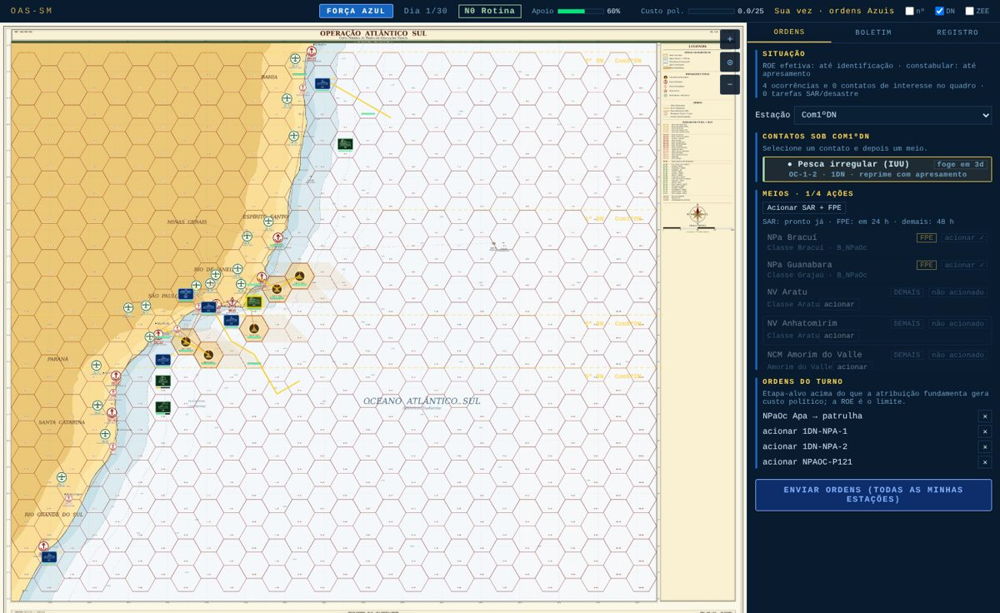

# SM-9 — Interface interativa (único, 1×1 e estações distribuídas)

**Estado:** concluída · **Especificação:** Conceito v1.6 §5 (C2 e modalidades), §8.5 (Célula Branca), §8.7 (fontes), §10 (configurador e boletim); Desenho Experimental v1.3 §2.2.



## O que foi feito

| Arquivo | Conteúdo |
|---|---|
| `shared/sm/engine.js` | Motor de turno em etapas: `criarPartida(cfg)` → `iniciarTurno(decisaoVermelho)`, `decidirAzul(decisoes)`, `fecharTurno(autorizacao)`, `intervir(req)`, visões por papel (`situacaoAzul`, `situacaoVermelho`, `situacaoCelula`), `boletim`, `metricas`, `resultado`. Onde falta decisão humana, aplica a doutrina da SM-8. |
| `shared/sm/runner.js` | `jogarPartida` passa a ser o laço do motor com todas as decisões doutrinárias. O lote não mudou: o CSV das 1.040 partidas é **idêntico byte a byte** ao da SM-8. |
| `shared/sm/sala.js` | Sala de jogo independente de transporte: assentos por modalidade, fases (`lobby → vermelho → azul → escalada → … → encerrada`), validação de papel (`C2.exigirDecisao`), visão de cada assento. |
| `sm_server.js` | Transporte Socket.IO no namespace `/sm` (criar, consultar, entrar/reconectar por token, iniciar, enviar). |
| `server.js` | **Única mudança em arquivo do jogo base:** 3 linhas — rota `/sm` e `attach` do namespace. |
| `public/sm.html`, `public/js/sm_client.js`, `public/css/sm.css` | Configurador, sala de espera e tela de jogo. Reaproveita a carta, os hexágonos e os ícones do jogo base (`hex.js`, `terrain.js`, `units.js`) sem alterá-los. |
| `shared/sm/params.js` | `HIBRIDO.maxAcoesHumano: 2` — teto de ações do Vermelho humano por turno. `// TODO: validar com especialista` |
| `scripts/test_sm_sala.js` | 37 verificações, incluídas no `npm test`. |
| `scripts/e2e_sm_ui.js` | Verificação funcional no navegador (Playwright), fora do `npm test`. |

## Modalidades

| Modalidade | Assentos | Quem decide o que falta |
|---|---|---|
| Jogador único | Azul (todas as estações) | Vermelho pelo motor |
| Confronto 1×1 | Azul e Vermelho | — (exige a trilha de defesa) |
| Estações distribuídas (EM) | COMPAAz, Esquadra, 1º, 2º, 5º e 8º DN; Célula Branca opcional | Estações vazias pelo agente (doutrina); Vermelho pelo motor ou pela Célula Branca |

A sala recusa a Célula Branca fora do modo distribuído e o 1×1 sem a trilha de defesa.

## Tela de jogo

- **Cabeçalho:** papel, dia, postura (N0–N3), apoio público, custo político / teto, fase e vez.
- **Carta OAS-MAP-001:**
  - limites dos DN e faixa da ZEE (liga/desliga);
  - infraestrutura com barra de pontos;
  - ocorrências como marcadores neutros e ações híbridas como marcadores vermelhos;
  - meios Azuis agrupados por hexágono.
- **Aba Ordens:**
  - **Azul:** contatos e meios da estação; designação com etapa-alvo (até o teto da ROE), patrulha e acionamento da prontidão.
  - **COMPAAz:** pedidos de apoio, campanha informacional e a proposta de escalada (Autorizar / Negar).
  - **Vermelho:** lance do turno (até 2 ações) e desinformação.
  - **Célula Branca:** controle do Vermelho e intervenções com justificativa obrigatória (anular lance, injetar crise/evento).
- **Aba Boletim:** probabilidades em palavras, ou em números com o botão "nº".
- **Aba Registro:** mensagens, recusas e intervenções.

## Determinismo e equivalência

- **Lote:** o lote pelo motor de etapas gera o mesmo CSV da SM-8.
- **Modalidades:** as mesmas ordens dadas no modo único ou distribuídas pelas estações produzem campanhas idênticas (teste em `test_sm_sala.js`). A modalidade muda quem decide, não a regra.
- **Vermelho:** a decisão é validada antes de qualquer mudança de estado, então um lance inválido não consome sorteios.

## Verificação funcional (demonstrador)

`node scripts/e2e_sm_ui.js --saida <dir>` sobe o servidor numa porta livre, joga as três modalidades no Chromium e salva capturas. Resultado:

- **Único:** a partida inicia, o plano é montado, os turnos avançam e o boletim aparece.
- **1×1:** a vez alterna Vermelho → Azul, e o dia 2 começa no lance Vermelho.
- **Distribuído:**
  - o agente conduz os assentos vazios;
  - a Célula Branca registra intervenção;
  - o turno resolve com COMPAAz e 1º DN humanos.
- **Página:** nenhum erro.

## Limitações conhecidas

- **Movimento:** a UI da SM não move hexágono a hexágono nem gasta pontos de combustível. Os meios são designados a contatos, como no motor (SM-4/SM-6).
- **Fontes de dados:** escolhidas só no configurador, não durante a partida.
- **Vermelho humano:** limitado a 2 ações por turno (placeholder).
- **Salas:** ficam em memória (limite de 200) e se perdem ao reiniciar o servidor.

## Como validar

```bash
node scripts/test_sm_sala.js          # só a SM-9
npm test                              # tudo
npm start                             # depois abrir http://localhost:3000/sm
node scripts/e2e_sm_ui.js --saida /tmp/sm-e2e   # demonstrador no navegador
```
